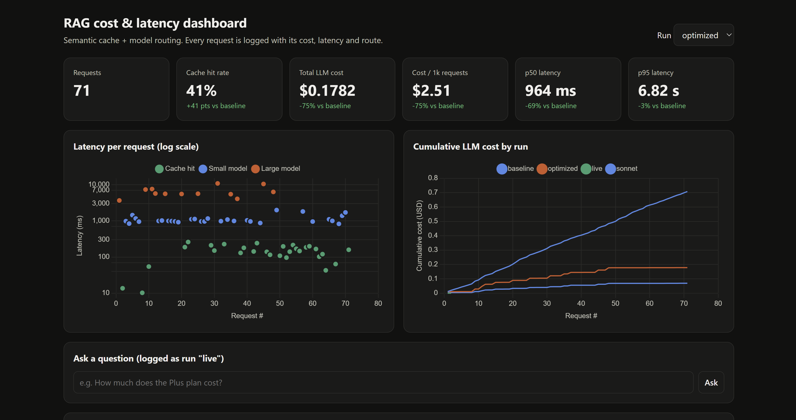

# RAG with Semantic Caching and Model Routing

A small question-answering service over a help center (a made-up cloud storage
company, "Lumen Drive"). On top of a plain RAG pipeline it adds two cost
optimizations and measures them:

1. **Semantic cache**: if a new question *means the same thing* as one already
   answered ("How much is Plus?" vs. "What's the price of Lumen Drive Plus?"),
   return the stored answer. That costs $0 and takes milliseconds.
2. **Cost-aware model routing**: simple lookups go to a small, cheap model
   (Claude Haiku 5.5). Questions that need reasoning go to a large model
   (Claude Opus 5.5).

A **dashboard** shows cost, p50/p95 latency and cache hit rate for every
request, and a **benchmark script** produces the before/after numbers.

```
                    ┌──────────────┐  hit   ┌─────────────────────┐
 question ──embed──▶│ semantic     │───────▶│ cached answer ($0)  │
                    │ cache        │        └─────────────────────┘
                    └──────┬───────┘
                       miss│
                           ▼
                    ┌──────────────┐        ┌─────────────────────┐
                    │ retrieve top │──────▶ │ router: easy / hard │
                    │ 4 doc chunks │        └──────┬───────┬──────┘
                    └──────────────┘          easy │       │ hard
                                                   ▼       ▼
                                             Haiku 5.5   Opus 5.5
                                                   │       │
                                                   └───┬───┘
                                                       ▼
                               answer + log (tokens, $, latency) ──▶ dashboard
```

## Results

Measured on 71 support questions (27 distinct questions, plus rewordings and
repeats), with the same questions sent through each setup. The baseline sends
every question to the most capable model (Opus 5.5) with no cache.

| Metric | Baseline (all Opus, no cache) | Cache + routing (Haiku / Opus) | Cache + routing (Haiku / Sonnet) |
|---|---|---|---|
| Cost per 1,000 questions | $9.97 | $2.51 (**-75%**) | $0.98 (**-90%**) |
| Median latency (p50) | 3.1 s | 1.0 s (**-69%**) | 0.9 s (**-71%**) |
| p95 latency | 7.0 s | 6.8 s (-3%) | 3.7 s (**-47%**) |
| Cache hit rate | 0% | 41% | 41% |
| Wrong cache hits | – | 0 | 0 |
| Answer quality (fact recall) | 92.0% | 91.6% | 91.6% |

Full reports: [Haiku / Opus](results/opus-run/benchmark.md) ·
[Haiku / Sonnet](results/benchmark-sonnet.md).

**What I learned.** The cache answered 41% of questions instantly for $0, and
Haiku handled most of the rest. With Opus as the large model, p95 barely moved,
because the 12 hardest questions still waited on Opus. Swapping in Sonnet for
those questions gave the same fact recall on them (88.9% for both) at about a
third of the cost and half the tail latency. The caveat: 12 hard questions is a
small sample, and fact recall checks facts rather than reasoning quality.



*The dashboard for the Haiku / Opus run. Left: each dot is one question. Cache
hits (green) come back in under 300 ms, Haiku (blue) in about 1 s, and Opus
(orange) in 3–10 s. Right: running cost. The top line is the all-Opus baseline,
the orange line is cache + Haiku/Opus, and the bottom line is cache + Haiku/Sonnet.*

## Setup (about 5 minutes)

You need Python 3.10 or newer and an Anthropic API key
([console.anthropic.com](https://console.anthropic.com), add a few dollars of credit).

```bash
cd rag-cache-router
python -m venv .venv
source .venv/bin/activate          # Windows: .venv\Scripts\activate
pip install -r requirements.txt
cp .env.example .env               # then open .env and paste your API key
```

The first run downloads a small embedding model (~130 MB, runs locally for free).

## 1. Run the benchmark (your resume numbers)

First a free dry run with a fake LLM, to check everything works:

```bash
python benchmark.py --mock
```

Then the real run. It sends about 70 questions through both setups and cost
about **$0.90** in API usage when last measured:

```bash
python benchmark.py
```

It compares:

| | Baseline | Optimized |
|---|---|---|
| Cache | off | semantic cache |
| Model | every question → Opus 5.5 | Haiku 5.5 or Opus 5.5, picked by the router |

and writes `results/benchmark.md` with a table like this (placeholders shown):

| Metric | Baseline | Optimized |
|---|---|---|
| Total LLM cost | $X | $Y |
| p95 latency | X s | Y s |
| Cache hit rate | 0% | Z% |
| Answer quality (fact recall) | A% | B% |

plus a suggested resume line filled in with your real numbers. If quality
drops by more than 2 points, it tells you that instead of writing the line.

Per-request details (route, cache similarity, answer) go to `results/requests.csv`.

**Experiments.** To try a different large model for the optimized side without
paying for the baseline again:

```bash
python benchmark.py --reuse-baseline --large-model claude-sonnet-5-5 --name sonnet
```

This writes `results/benchmark-sonnet.md` and shows up as its own run in the dashboard.

## 2. Open the dashboard

```bash
uvicorn app:app --reload
```

Open http://localhost:8000. Pick a run (`baseline`, `optimized`, or `live`) to
see its KPIs and the change against baseline, a latency chart colored by route
(cache / small / large), cumulative cost by run, and the latest requests with
the reason for each routing decision. You can also type questions into the
"Ask" box; they're logged as the `live` run.

The API works on its own too:

```bash
curl -X POST localhost:8000/api/ask -H "Content-Type: application/json" \
     -d '{"question": "How much does the Plus plan cost?"}'
```

## 3. Tune the cache threshold (free, no LLM calls)

```bash
python tune_threshold.py
```

For every pair of eval questions it checks how similar they look to the
embedding model and whether they're actually the same question. It prints how
many paraphrases you'd catch and how many wrong matches you'd risk at each
threshold. Put the best value in `.env` as `CACHE_THRESHOLD`, then re-run the
benchmark.

## How each piece works

| File | What it does |
|---|---|
| `ragcache/retriever.py` | Splits `data/docs/*.md` into chunks, embeds them, finds the top 4 for a question |
| `ragcache/embeddings.py` | Local embeddings with `BAAI/bge-small-en-v1.5` via fastembed (free, no API) |
| `ragcache/cache.py` | Semantic cache: cosine similarity ≥ threshold, plus a key-term guard and a TTL |
| `ragcache/router.py` | Scores how "hard" a question is and picks the model |
| `ragcache/llm.py` | Calls Claude, measures tokens, cost and latency |
| `ragcache/metrics.py` | Logs each request to SQLite, computes p50/p95, hit rate and cost |
| `ragcache/service.py` | Ties it together: cache → retrieve → route → generate → log |
| `app.py`, `static/dashboard.html` | API and dashboard |
| `benchmark.py` | Baseline vs. optimized on the same workload |
| `tune_threshold.py` | Picks a safe cache threshold without calling the LLM |
| `eval/questions.json` | 27 questions with paraphrases, difficulty labels and required facts |
| `ragcache/config.py` | All settings: models, prices, thresholds |

**The semantic cache.** Each question becomes a vector, and similar meanings
give similar vectors. If the closest cached question has cosine similarity of
0.90 or more, its answer is reused. Embeddings have one known weakness: "How
long are files kept in the trash on the **Plus** plan?" and "...on the **Free**
plan?" look almost identical but have different answers. So the cache also
requires both questions to mention the same plan names, platforms and numbers.
The eval set includes three of these near-miss questions on purpose, and the
benchmark counts any wrong cache hits.

**The router.** It's rule-based, so every decision can be explained. Reasoning
words ("compare", "why", "should we", "what happens if") add 2 points, a
question with three or more parts adds 2, two parts adds 1, a long question
adds 1, and numbers to calculate with add 1. A score of 2 or more goes to the
large model. The dashboard shows the reason for each request.

**Measuring quality.** Each eval question lists facts a correct answer must
contain (for example "$8" and "$80" for the Plus price). Quality is the share of
those facts found in the answer. It's simple and transparent, but it's a proxy,
not a full grade.

## Talking about it honestly in interviews

These questions come up, so it helps to have answers ready:

- **The savings depend on the traffic.** The benchmark workload repeats and
  rewords questions on purpose, because real support traffic does. With
  all-unique questions the cache would rarely hit, and the savings would come
  from routing alone.
- **The router rules were written while looking at this eval set**, so its
  accuracy here is optimistic. To check it properly, write 20 new questions,
  label them easy/hard, and look at the router accuracy row.
- **Cache staleness.** If the docs change, cached answers can go out of date.
  That's what the TTL is for (24 hours by default); a real system would also
  clear the cache when docs are updated.
- **Why not always use the small model?** Run with `ROUTER_HARD_THRESHOLD=99`
  (everything goes to Haiku) and compare quality on the hard questions. That
  experiment is a good thing to mention.

## Ideas to extend it

- Replace the rule router with a small classifier, or let Haiku decide "easy or hard".
- Use Anthropic prompt caching for the system prompt (a third cost lever).
- Add an LLM-as-judge quality score next to fact recall.
- Persist the semantic cache in SQLite or Redis so it survives restarts.

## Offline test mode

`EMBEDDER=hash` swaps in a keyword-hashing embedder that needs no download, and
`--mock` / `MOCK_LLM=1` use a fake LLM. They're for testing the plumbing only:
hashing doesn't understand paraphrases, and mock numbers are simulated.
